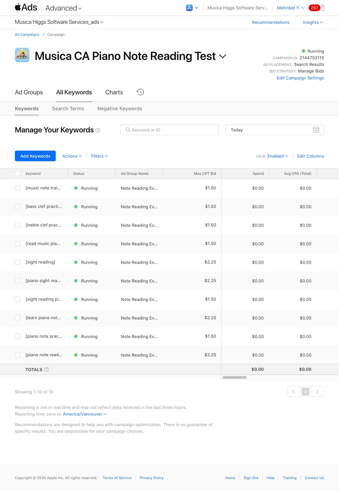
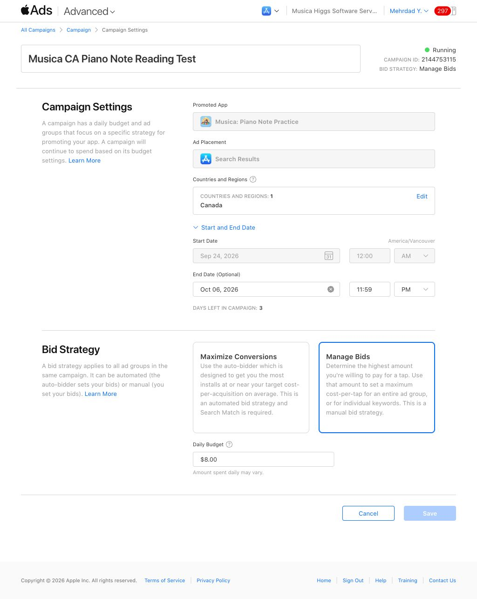

# Musica controlled bid test — October 3, 2026

Verified 2026-10-03 14:57 PDT. User approved the proposed test and extension.

Baseline: Last 30 days and Today separately both zero spend, impressions, taps and attributed installs. Campaign, ad group, keywords Running; Default Ad Active. Latest three hours may be absent.

Raised exact [sight reading], [piano sight reading], [learn piano notes], [piano note reading] from CAD 1.50 to CAD 2.25. Six other keywords unchanged. Apple recommendations reviewed but unrelated; this bid is an experiment, not an Apple recommended value for these terms.

Campaign ends October 6, 2026 at 23:59 America/Vancouver; CAD 8/day unchanged. Canada, Search Results, manual bids, Search Match Off, all eligible users unchanged. No ad-group end date or CPA cap. Settings reopened and verified.

Review after 24–48 hours; no automatic check scheduled. Diagnose delivery first, then installs and subscription quality. Different keywords are not a randomized control.

