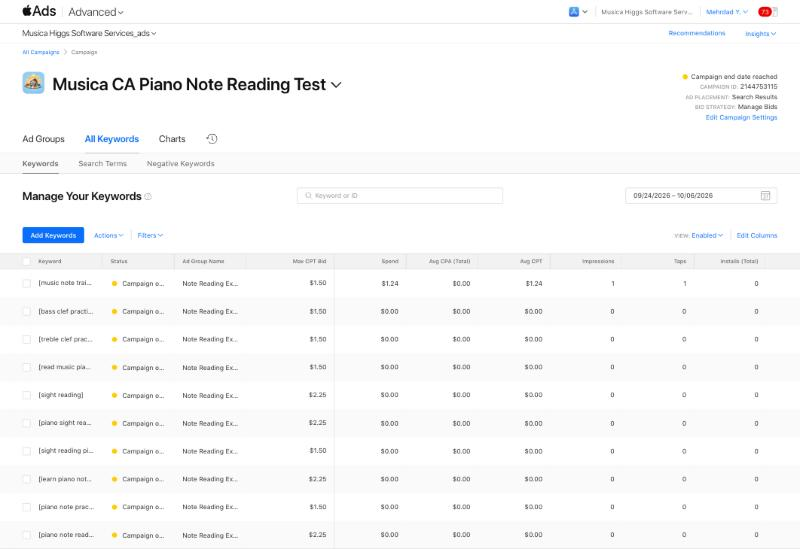
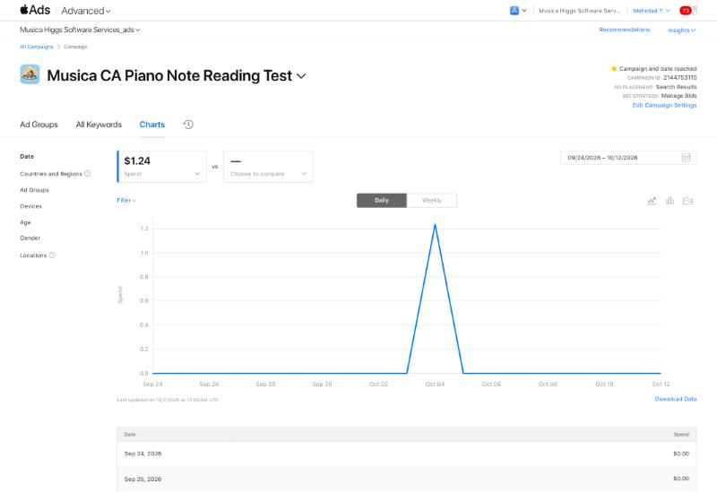
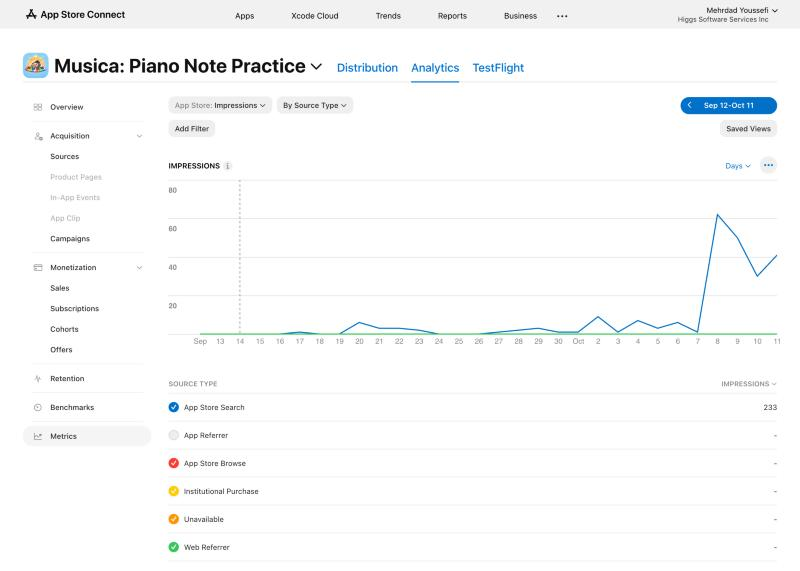
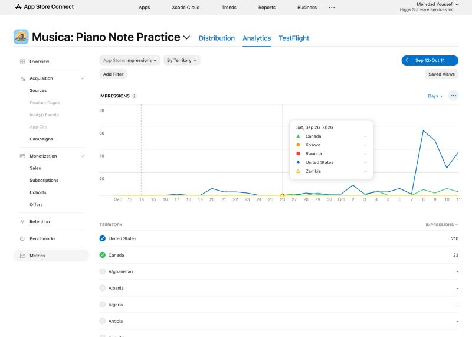

# Musica campaign final audit — October 12, 2026

Read-only audit, 2026-10-12 around 17:00 PDT, in the in-app browser after Mehrdad signed in. Nothing in Apple Ads or App Store Connect was changed.

## Status

- Campaign **Musica CA Piano Note Reading Test** (2144753115): **Campaign end date reached**. Ad group 2151353472 shows On hold, and all ten keywords show Campaign on hold.
- Change history from Sep 24 to Oct 12 (UTC) shows nothing after the Oct 3 21:54–21:55 UTC edits (four keyword bids, campaign end date). Nobody changed anything after the bid test.
- Saved bids match the handoff: four keywords at CAD 2.25 and six at CAD 1.50. Search Match is Off.

## Apple Ads results, Sep 24 – Oct 6 (America/Vancouver)

| Keyword | Max CPT | Spend | Impr. | Taps | Installs |
|---|---:|---:|---:|---:|---:|
| [music note trainer] | 1.50 | **1.24** | **1** | **1** | 0 |
| other nine keywords | 1.50 / 2.25 | 0.00 | 0 | 0 | 0 |
| **Total** | | **CAD 1.24** | **1** | **1** | **0** |

- Total installs, tap-through installs and view-through installs were all 0. Avg CPT was CAD 1.24, TTR 100% (1/1) and CR 0%.
- The search-term report shows the impression only as "(Low volume terms)".
- Daily spend was CAD 0 every day except **Oct 4: CAD 1.24**. Oct 7–12 was CAD 0 each day, so nothing ran after the end date. The chart said "Last updated on 10/7/2026 at 12:00AM UTC".
- By phase: Sep 24–27 initial = 0. Sep 28–Oct 2 broader audience = 0. Oct 3 = 0. **Oct 4–6 higher bids = 1 impression, 1 tap, CAD 1.24, 0 installs**.
- **The four raised keywords got zero impressions**, even at CAD 2.25. The one impression came from a keyword whose bid stayed at CAD 1.50. This means bid level was not what held delivery back. These exact terms barely get searched in Canada.

## Billing

- Invoices for the last 30 days: one invoice, **Oct 11, 2026, CHARGED, CAD 0.00 subtotal / 0.00 tax / 0.00 total**. The card was charged nothing.
- The promo credit row still shows only "Date Applied September 25, 2026". The amount, remaining balance and expiry are **not shown**. Most of the credit is presumably unused, but this is unverified.
- Of the CAD 100 authorization, CAD 1.24 of media was used.

## App Store Connect context (UTC days, Sep 12 – Oct 11)

| Metric | Value |
|---|---|
| Impressions | **233**, all App Store Search. United States 210, Canada 23 |
| Product page views | 5 (Sep 29, Oct 4, Oct 6, Oct 8, Oct 11) |
| First-time downloads | 1 (Oct 9; source type "Unavailable") |
| 90-day overview (Jul 14 – Oct 11) | 4 first-time downloads, 1 redownload, 266 impressions, 17 page views, 1 IAP (the IAP count is unchanged since the Sep 13 audit) |
| Proceeds, paying users, subscriptions | Not Enough Data |

Daily impressions: Sep 17–Oct 7 were 0–9 per day. Then **Oct 8: 62, Oct 9: 50, Oct 10: 30, Oct 11: 41**. The jump is mostly in the **US** and begins two days after the campaign ended, so it is organic and not from the ad. The cause has not been identified.

The Oct 4 product page view lines up with the ad tap on Oct 4, but there is no attribution link to confirm it. The Oct 9 download came three days after the campaign ended and is not attributable to it.

## Interpretation

1. **The paid test answered its question: there is almost no exact-match search volume for these ten terms in Canada.** Thirteen days produced one impression. Raising bids by 50% did not unlock any delivery on the raised terms. A bigger budget or higher bids on the same setup would not fix this.
2. **The organic picture changed.** US search impressions went from roughly 0–3 per day to 30–60 per day starting Oct 8. That is now far more exposure than the ads ever produced.
3. **The new bottleneck is the search result tile.** 233 impressions led to 5 page views (about 2%) and 1 download. The icon, name, subtitle and first screenshots decide this step.
4. Subscription impact cannot be measured from this data (Not Enough Data, no attribution). This does not mean zero.

## Next decision (one)

**Do not restart the Canada exact-match campaign as configured.** Choose one next step:

- **Free, recommended first:** improve the search tile conversion for the US traffic that is now arriving. Check how the tile looks for real US searches, then test a clearer first screenshot and subtitle. To find which queries are driving the Oct 8 jump, look in App Store Connect → Acquisition → Sources → App Store Search, or Apple Ads → Insights.
- **Paid, needs a new OK from Mehrdad:** a small **US** discovery campaign using the remaining promo credit, with **Search Match on** (or broad match) for a fixed period such as 7 days at CAD 8/day, so Apple can show which real queries have volume. First verify the remaining credit and its expiry.

No monitoring has been scheduled.

## Evidence

