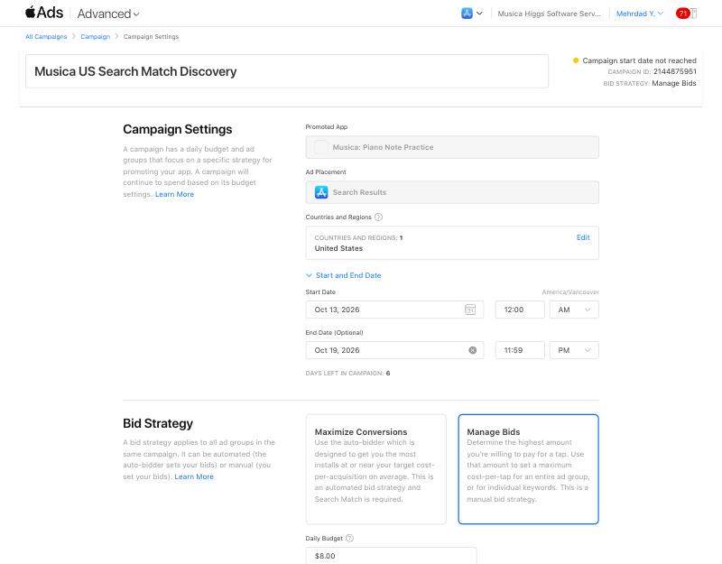
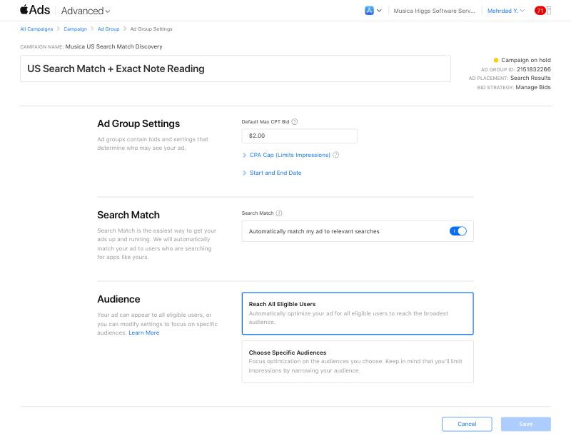
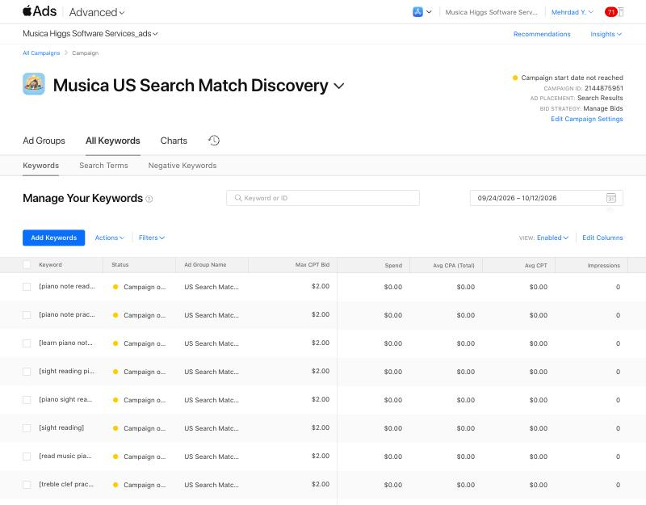
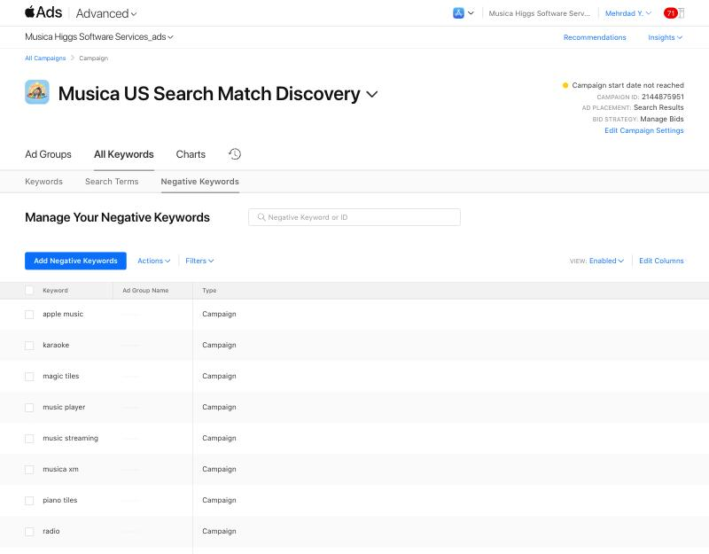

# US Search Match discovery campaign — created October 12, 2026

Mehrdad approved it in chat on 2026-10-12 with the exact settings below. The campaign was created around 17:40 PDT and its saved settings were reopened and checked. The status at creation was **Campaign start date not reached**.

## Why

The Canada exact-match test showed that those ten terms have almost no search volume ([final audit](2026-10-12-final-audit.md)). Organic US search impressions rose from Oct 8. This test lets Apple's Search Match find which real US searches will show Musica. Those queries then feed the 1.2 subtitle and keywords ([listing draft](../release-1.2-draft/README.md)).

## Saved settings

| Setting | Value |
|---|---|
| Campaign | **Musica US Search Match Discovery**, ID **2144875951** |
| Ad group | **US Search Match + Exact Note Reading**, ID **2151832266** |
| App / placement | Musica: Piano Note Practice / App Store Search Results |
| Country | United States only |
| Dates | **Oct 13, 2026 12:00 AM → Oct 19, 2026 11:59 PM**, America/Vancouver |
| Daily budget | CAD 8.00. Apple notes that daily spend may vary |
| Bid strategy | Manage Bids, default max CPT **CAD 2.00** (Apple suggested CAD 2.08) |
| Search Match | **On** |
| Keywords | The same ten exact terms as Canada, each at CAD 2.00. Apple shows popularity 1 of 5 for every one of them in the US |
| Campaign negatives (broad) | spotify, apple music, youtube music, music player, music streaming, radio, karaoke, piano tiles, magic tiles, musica xm |
| Audience | Reach All Eligible Users |
| Ad | Default product page (1.1 screenshots) |
| CPA cap / ad group end date | None. The campaign end date controls the stop |

Apple's recommended keywords (Instagram, X, Snapchat, TikTok, etc.) were ignored as unrelated.

## Budget

- Planned maximum is about CAD 56 of media (7 × CAD 8). Daily spend can vary.
- It is expected to come out of the remaining App Store promo credit. That credit was USD 100 converted to CAD; CAD 1.24 has been used so far.
- Apple's promo terms say credit cannot pay taxes or fees, so any tax goes to the card on file.
- The remaining balance can only be worked out from invoices. Apple shows no balance or expiry for this credit.

## Success and stop rules

- **Stop early** if about 15 taps bring 0 installs. This is a review trigger, not proof.
- **Useful result:** a list of real US search terms with impressions and taps (All Keywords → Search Terms). Also note installs and the cost per install.
- A one-time check-in is scheduled for **Oct 16, 2026, 10:00 AM PDT** (desktop scheduled task `musica-us-ads-oct16-checkin`, at Mehrdad's request). It writes `2026-10-16-us-check-in.md`. After Oct 19, run a final audit. Report Oct 13–19 in America/Vancouver time, and expect some reporting lag.

## Evidence

