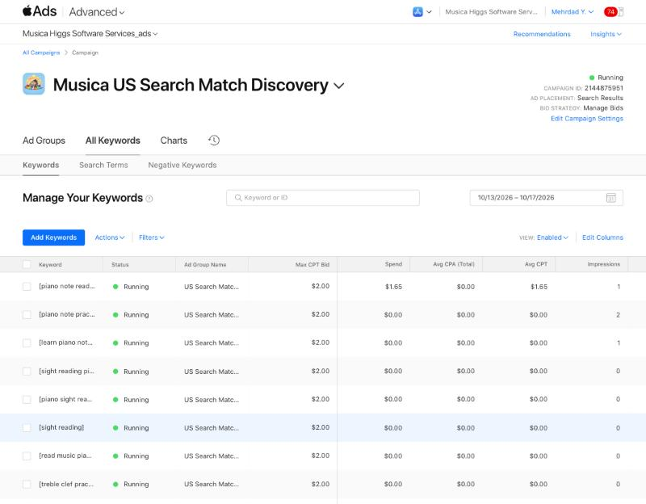
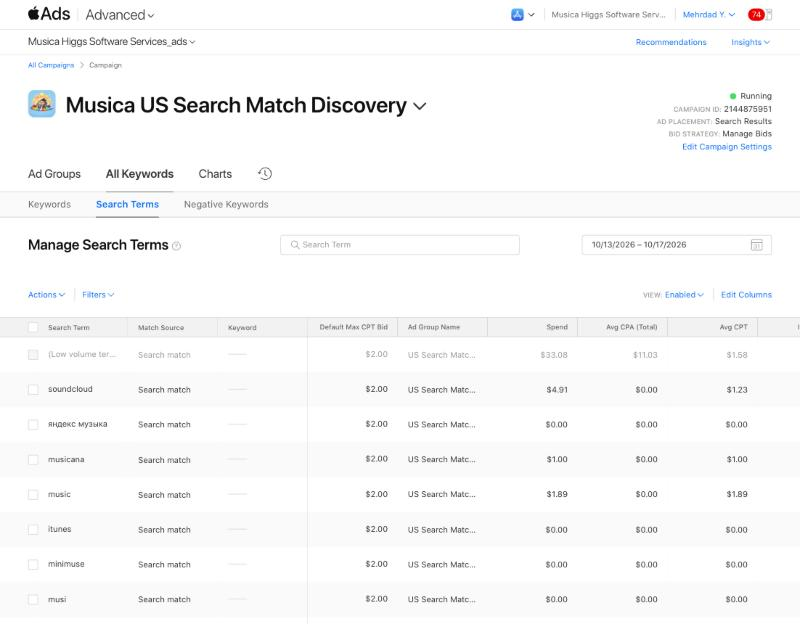
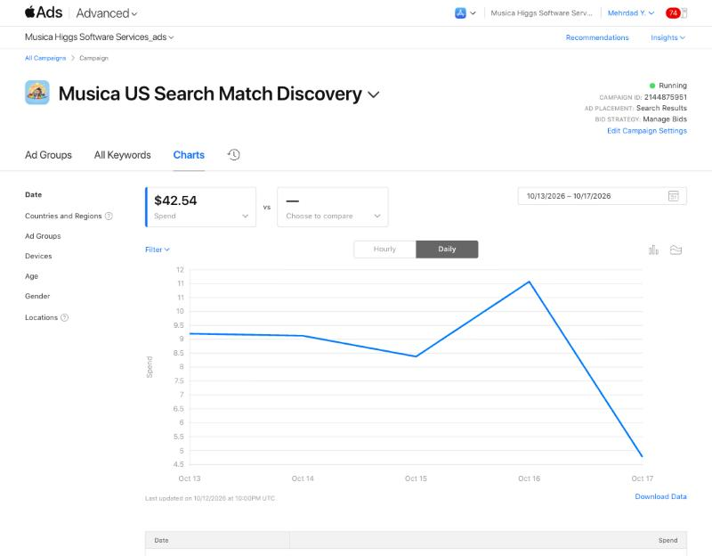
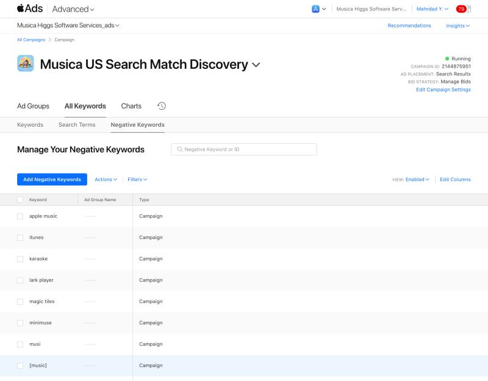

# US Search Match campaign check-in — October 17, 2026

This was a read-only check, pulled around 15:20 PDT on 2026-10-17. Mehrdad had to sign in first.

The scheduled Oct 16 run (`musica-us-ads-oct16-checkin`) started on time but stalled. Apple Ads had signed out, and the run sat at the sign-in page without writing a report. Nothing was changed in Apple Ads.

Campaign **2144875951** shows **Running**. Change history for Oct 13–17 is empty, so the settings are unchanged since creation.

## Totals, Oct 13–17, 2026 (America/Vancouver; Oct 17 is partial)

From the Search Terms tab, which includes Search Match and keywords:

| Spend | Impressions | Taps | Installs | TTR | Conversion | Avg CPT | Cost per install |
|---:|---:|---:|---:|---:|---:|---:|---:|
| **CAD 42.54** | **1,981** | **28** | **3** | 1.41% | 10.71% | CAD 1.52 | **CAD 14.18** |

The installs are all tap-through (3).

**Daily spend:** Oct 13 9.20 · Oct 14 9.13 · Oct 15 8.38 · Oct 16 11.07 · Oct 17 4.77 so far.

Apple is spending above the CAD 8/day target on most days. Its UI says daily spend may vary. At this rate the full run will come to about CAD 60–65, not the ~CAD 56 planned.

**Stop rule** (15+ taps with 0 installs): **not triggered**, because there were 3 installs. No change was made.

## Search terms

| Search term | Source | Spend | Impr. | Taps | Installs |
|---|---|---:|---:|---:|---:|
| (Low volume terms) | Search Match | 33.08 | 1,244 | 21 | **3** |
| soundcloud | Search Match | 4.91 | 229 | 4 | 0 |
| яндекс музыка | Search Match | 0 | 111 | 0 | 0 |
| musicana | Search Match | 1.00 | 84 | 1 | 0 |
| music | Search Match | 1.89 | 79 | 1 | 0 |
| itunes | Search Match | 0 | 52 | 0 | 0 |
| minimuse | Search Match | 0 | 43 | 0 | 0 |
| musi | Search Match | 0 | 41 | 0 | 0 |
| touchtunes | Search Match | 0 | 23 | 0 | 0 |
| piano | Search Match | 0 | 16 | 0 | 0 |
| lark player | Search Match | 0 | 13 | 0 | 0 |
| garageband | Search Match | 0 | 12 | 0 | 0 |
| bandlab | Search Match | 0 | 10 | 0 | 0 |
| я музыка | Search Match | 0 | 10 | 0 | 0 |
| موسيقى | Search Match | 0 | 10 | 0 | 0 |
| piano note practice | Keyword | 0 | 2 | 0 | 0 |
| piano note reading | Keyword | 1.65 | 1 | 1 | 0 |
| learn piano notes | Keyword | 0 | 1 | 0 | 0 |

The other seven exact keywords got 0 impressions.

## Billing

- No new invoice yet. The only invoice in the last 30 days is still Oct 11 at CAD 0.00. The US spend has not been billed.

## App Store Connect (UTC days, Oct 10–16)

- **Product page views:** 25 in total. Oct 13: 8, Oct 14: 5, Oct 15: 5, Oct 16: 6. That's up from about 0–1 a day before.
- **First-time downloads:** 2 (Oct 14 and Oct 16).
- Apple Ads counts 3 installs. Its count includes redownloads, and its days use a different time zone, so the two numbers won't match exactly.

## What it means

1. **Search Match mostly ties Musica to music-player searches**, not piano searches: soundcloud, Yandex Music, iTunes, Musi, "music", in several languages. The name "Musica" is pulling streaming intent, as the earlier handoff warned. Those searches almost never tap.
2. **The 3 installs all came from hidden "low volume" terms.** That's long-tail traffic Apple won't name. Cost per install is about CAD 14.
3. **Real piano-practice searches are rare in the US too.** "piano" got 16 impressions, and the exact note-reading terms got 4 in total.
4. This probably also explains the organic picture. The US impression jump from Oct 8 with a ~2% tap rate fits music-player searchers seeing a piano-practice app. That is an inference, not verified.

## Change made after this check (approved by Mehrdad in chat, 2026-10-17 ~15:35 PDT)

Added 11 campaign negative keywords:

- **broad:** soundcloud, itunes, musi, touchtunes, lark player, musicana, minimuse, яндекс музыка, я музыка, موسيقى
- **exact:** [music]

The campaign now has 21 negatives. Everything else is unchanged: budget, bids, dates, keywords, audience and Search Match. The list was reopened after saving and checked.

## Recommendation that led to the change

For the last ~2.5 days, add campaign negatives for the clearly unrelated terms so spend shifts toward the long-tail terms that converted:

- soundcloud, itunes, musi, touchtunes, lark player, musicana, minimuse, яндекс музыка, я музыка, موسيقى (broad)
- music (exact only, so "music notes"-style searches stay eligible)

For 1.2, keep the listing clearly "piano note practice", and don't add more generic "music" wording. The draft subtitle "Read music on a real piano" adds the word "music". Given this data, reconsider it against a piano-first option, such as "Piano sight reading for kids".

## Evidence

