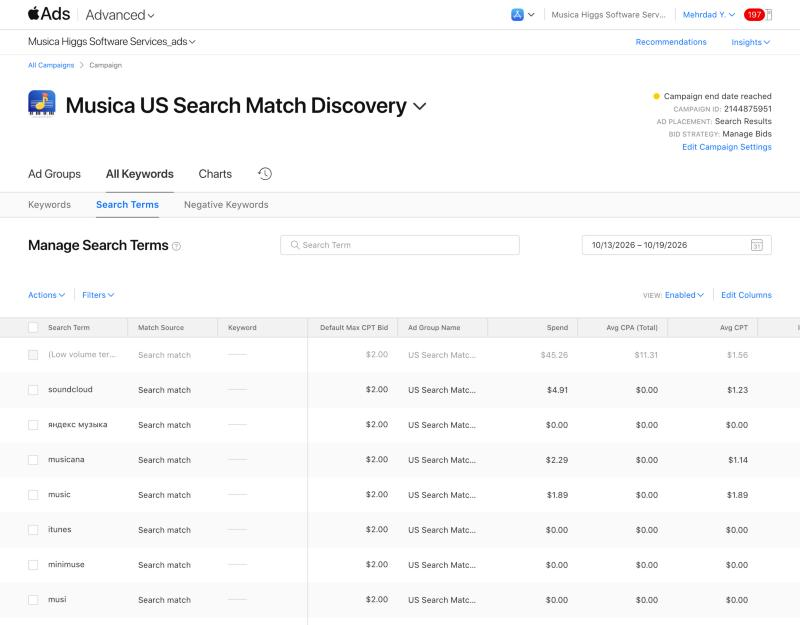
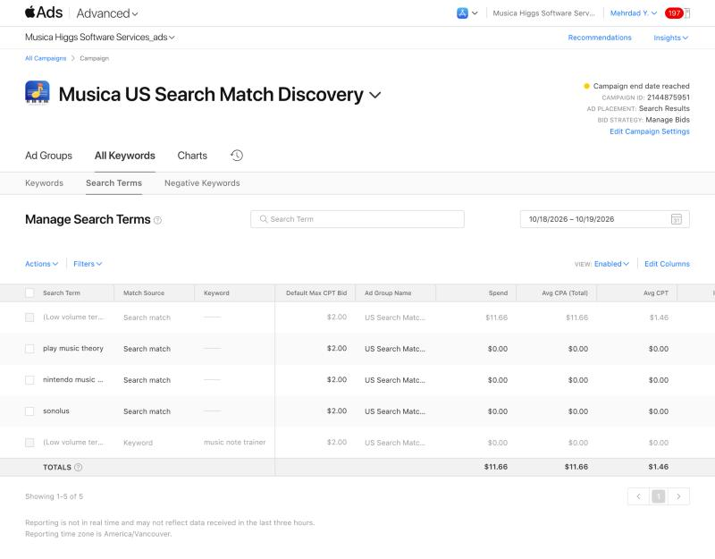

# US Search Match campaign — final audit, October 20, 2026

This was a read-only check, pulled around 05:20 PDT on 2026-10-20. Apple Ads was still signed in. Campaign **2144875951** shows "Campaign end date reached". Nothing was changed.

Context: the app went live as **Note School: Piano Reading** (1.2) on Oct 18 at about 14:00 PDT. The 11 music-player negatives were added on Oct 17 at about 15:35 PDT.

## Apple Ads results (America/Vancouver days)

| Period | Spend (CAD) | Impressions | Taps | Installs | TTR | Cost per install |
|---|---:|---:|---:|---:|---:|---:|
| **Oct 13–19 (whole test)** | **56.00** | **2,597** | **37** | **4** | 1.42% | **14.00** |
| Oct 13–17 (old name; negatives added Oct 17 pm) | 44.34 | 2,007 | 29 | 3 | 1.44% | 14.78 |
| Oct 18–19 (rename live from Oct 18 pm) | 11.66 | 590 | 8 | 1 | 1.36% | 11.66 |

The Oct 13–17 row is the whole week minus Oct 18–19.

- **Daily spend:** 9.20 · 9.13 · 8.38 · 11.07 · 6.57 · 6.88 · 4.77. The total came to exactly 7 × CAD 8.
- **Daily ad impressions:** 546 · 511 · 561 · 275 · 114 · 351 · 239.
- All 4 installs came from Search Match **"(Low volume terms)"**: 1,792 impressions, 29 taps, CPA CAD 11.31. Apple does not name these searches.
- The exact keywords got 5 impressions and 1 tap ([piano note reading]) all week, with 0 installs.
- **Visible search terms, whole week:**
  - soundcloud: 229 impressions, 4 taps
  - яндекс музыка: 111, 0
  - musicana: 102, 2
  - music: 79, 1
  - itunes: 52, 0
  - minimuse: 43, 0
  - musi: 41, 0
  - play music theory: 24, 0
  - touchtunes: 23, 0
  - piano: 16, 0
  - nintendo music app: 14, 0
  - lark player: 13, 0
  - garageband: 12, 0
  - sonolus: 11, 0
  - bandlab: 10, 0
  - я музыка: 10, 0
  - موسيقى: 10, 0
- **Oct 18–19 visible terms:** only play music theory (24), nintendo music app (14) and sonolus (11), all with 0 taps. The music-player negatives worked, since none of the blocked terms appear after Oct 17. Search Match still leans toward music apps in general.

## Billing

- New invoice **Oct 20, 2026, CAD 0.00 subtotal / 0.00 tax / 0.00 total** (billing entity Apple Inc.). The earlier Oct 11 invoice was also CAD 0.00. The card has been charged nothing.
- Total media used: CAD 1.24 (Canada) + CAD 56.00 (US) = **CAD 57.24**.
- The remaining App Store promo credit is roughly CAD 75–80. That's an estimate: the USD 100 credit converted at an unknown rate, minus 57.24. Apple shows no balance.

## App Store Connect (UTC days)

| | Oct 13 | 14 | 15 | 16 | 17 | 18 | 19 |
|---|---:|---:|---:|---:|---:|---:|---:|
| Impressions (all sources) | 677 | 659 | 790 | 598 | 293 | 293 | 773 |
| Product page views | 8 | 5 | 5 | 6 | 4 | 4 | 5 |
| First-time downloads | – | 1 | – | 1 | 2 | 1 | **3** |

- **First-time downloads, Oct 13–19: 8.** Apple Ads counts 4 installs, so about 4 came from elsewhere. For comparison, Sep 12 – Oct 11 had 1 first-time download in 30 days.
- **Oct 19 had 3 first-time downloads, the best day so far.** It was the first full UTC day after the rename. Ads recorded only 1 install on Oct 18–19, so at least 2 of those 3 were not from ads.
- **A rough non-ad impression estimate** (App Store Connect total minus Apple Ads; the time zones differ by 7 hours): Oct 13–17 about 1,010 (~200/day), Oct 18–19 about 476 (~240/day). Before the campaign, Oct 8–12 ran 30–62/day. App Store Connect's search impressions include ad views, so treat this split as approximate.
- **Ratings:** still 0 in both the US and Canada.

## What it means

1. **Paid:** CAD 56 bought 37 taps and 4 installs, about **CAD 14 per install**, all covered by the promo credit. The installs come from long-tail searches Apple won't name. The music-player traffic is now blocked.
2. **Downloads moved:** 8 in this week, against about 1 per month before. Some of that came from the ads, and some appears to be organic.
3. **The rename has one good day of data** (Oct 19: 3 downloads). That's encouraging but not proof. A clean week without ads is needed to judge it.

## Recommended next decision

- **Oct 20–26:** run no ads, and measure Note School's organic impressions, page views and downloads cleanly.
- **Then:** if worthwhile, run a second 7-day US Search Match week (CAD 8/day, same negatives) on the new name, to compare with the Musica week. That needs Mehrdad's OK and would use most of the remaining credit.
- Keep working on the first ratings (direct asks to real users, teachers).

## Evidence

