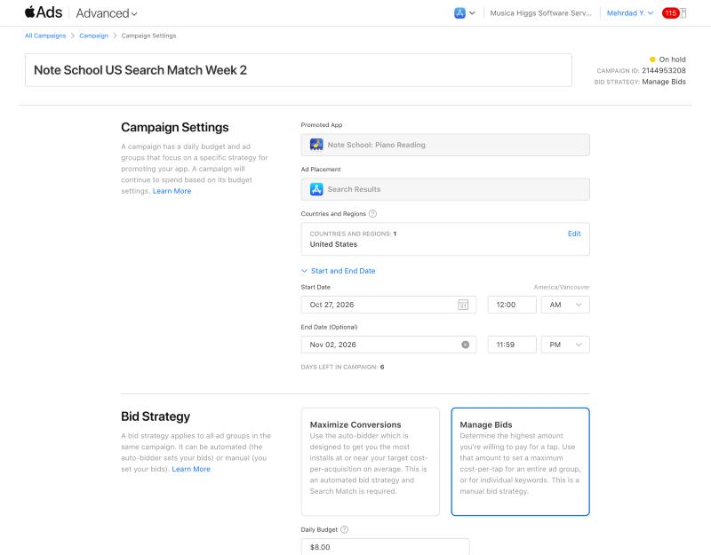

# US Search Match week 2 (Note School) — created October 24, 2026

Mehrdad approved it in chat on 2026-10-24 ("yes, set it up"). The goal is to repeat week 1 with only the app name changed, so the results compare Musica with Note School.

| Setting | Value |
|---|---|
| Campaign | **Note School US Search Match Week 2**, ID **2144953208**. Made by duplicating 2144875951 |
| Ad group | US Search Match + Exact Note Reading, ID **2152146919** |
| Dates | **Oct 27, 2026 12:00 AM → Nov 2, 2026 11:59 PM**, America/Vancouver (DST ends Nov 1) |
| Budget / bid | CAD 8/day, Manage Bids, default max CPT CAD 2.00 |
| Search Match | On |
| Keywords | Same 10 exact terms as week 1 |
| Campaign negatives | Same 21 as week 1: 20 broad plus [music] exact |
| Audience / ad | Reach All Eligible Users / default product page (now the Note School listing) |

- **Gotcha:** the Duplicate dialog read the start/end times as UTC. It saved Oct 26 5:00 PM → Nov 2 4:59 PM Vancouver time. Both were corrected on the campaign settings page, then reopened and verified.
- The ad group start date came over as Oct 26 5:00 PM. The campaign start (Oct 27 00:00) is what actually gates delivery.
- Status at creation: On hold, because the campaign and ad group start dates haven't been reached.
- **Budget:** about CAD 56 of media, expected to come from the remaining promo credit (estimated at CAD 75–80). Any tax goes to the card.
- **Stop rule** (same as week 1): pause if about 15 taps bring 0 installs.
- **Compare against week 1** (Oct 13–19: CAD 56, 2,597 impressions, 37 taps, 4 installs, TTR 1.42%). Also compare the App Store Connect downloads.

