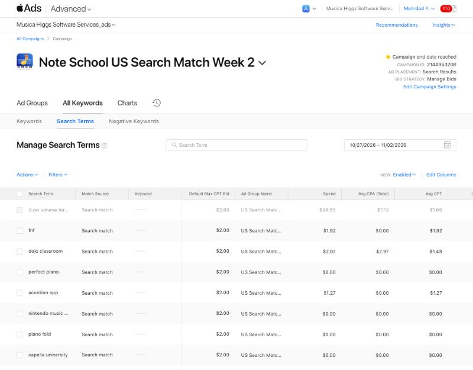

# US Search Match week 2 (Note School): final results — checked Nov 8, 2026

This was read-only, after a re-sign-in. App Store Connect had defaulted to the **Relentless Ventures** team; it was switched back to Higgs Software Services before reading, and nothing was touched in Relentless. Campaign **2144953208** shows "Campaign end date reached".

## Week 1 vs week 2 (Apple Ads, America/Vancouver)

| | Week 1: Musica name → Note School from Oct 18 pm (Oct 13–19) | **Week 2: Note School (Oct 27 – Nov 2)** |
|---|---:|---:|
| Spend | CAD 56.00 | **CAD 56.00** |
| Impressions | 2,597 | **1,247** |
| Taps | 37 | **34** |
| Installs (all tap-through) | 4 | **8** |
| TTR | 1.42% | **2.73%** |
| Tap → install | 10.81% | **23.53%** |
| Cost per install | CAD 14.00 | **CAD 7.00** |
| Avg CPT | CAD 1.51 | CAD 1.65 |

- **Caveat:** week 2 had all 21 negatives from day one. Week 1 got the 11 music-player negatives only on Oct 17 pm. Week 2's gain comes from both the rename/new icon and the cleaner traffic; it can't be split between them.
- Apple Ads "installs" include redownloads.

## Week 2 search terms

- **(Low volume terms): 990 impressions, 30 taps, 7 installs, CPA CAD 7.12.**
- **dojo classroom:** 39 impressions, 2 taps, **1 install** (CAD 2.97). This is a school/parent search, so the "School" name may be helping here.
- fnf: 60 impressions, 1 tap. friday night funkin: 15, 0.
- perfect piano: 34, 0.
- acordion app: 26, 1 tap.
- nintendo music app: 25, 0.
- piano fold: 25, 0. pianofold: 10, 0.
- capella university: 20, 0. It didn't grow after Oct 28.
- [piano note practice] keyword: 3, 0. The other exact keywords got 0.

## App Store Connect (UTC days)

- **First-time downloads:**
  - Oct 27–Nov 2: **8** (2, –, 1, 2, 1, 1, 1)
  - Nov 3–7: 1 (Nov 3 only)
  - Week 1 (Oct 13–19): also 8
  - The no-ads week (Oct 20–26): 2
- **Product page views:**
  - Oct 27–Nov 2: 31
  - Nov 3–7: 3
- **In-app purchases:** still only the Oct 16 one, with no new purchases or confirmed subscribers.
- **Ratings:** 0 in the US and Canada.

So **total new downloads were about 8 in each ad week**, against about 1–2 a week without ads. Week 2 got its downloads more cheaply through ads, but the total didn't grow, because week 1 also had about 4 non-ad downloads.

## Billing

- Invoice **Nov 3, 2026: CAD 0.00** (also Oct 11 and Oct 20). The card has been charged nothing.
- Media used on promo credit: 1.24 + 56.00 + 56.00 = **CAD 113.24**.
- The remaining credit is roughly **CAD 25**. That's an estimate: USD 100 converted at about 1.37–1.40, with no balance shown. The next paid week would mostly be charged to the card.

## What it means

1. The Note School listing **converts searchers about twice as well** as week 1 (TTR and tap→install both roughly doubled), and installs cost half as much.
2. Ads reliably bring about **8 downloads a week**. Without them it's about 1–2.
3. **Monetization and ratings haven't moved:** 1 purchase event in total and 0 ratings. Acquisition is no longer the main problem; activation, ratings and conversion to paid are.

## Recommended next step (needs Mehrdad's decision)

Pause paid ads before they start charging the card. Spend the next 1–2 weeks on:
- getting the first ratings (send the messages in `../outreach/rating-messages.md`)
- understanding whether new users actually practice and hit the paywall

Restart ads (CAD 8/day, CAD 7 target CPA) once there's a sign that downloads turn into practice and trials. The remaining ~CAD 25 of credit could fund about 3 more days if wanted.

