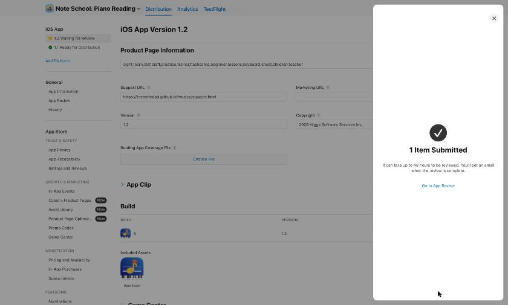

# Note School 1.2 release record

Submitted to App Review on **October 17, 2026, about 21:15 PDT**, at Mehrdad's request ("lock it in … submit it too"). App Store Connect then showed **1.2 Waiting for Review** and "1 Item Submitted".

- App: Apple ID 6794258266, bundle `com.higgssoftware.musica` (unchanged).
- Version/build: **1.2 (6)**. Archived and uploaded with `xcodebuild -exportArchive` (destination upload, team KQCJ2X2GSH). Apple finished processing it in under 15 minutes.
- Release setting: release automatically after approval, to all users at once. Existing ratings are kept.
- Code: commit `61e0b43` on `main`.

## What changed

| Field | 1.1 | 1.2 |
|---|---|---|
| App Store name | Musica: Piano Note Practice | **Note School: Piano Reading** |
| Home-screen name | Musica | **Note School** |
| Subtitle | Sight reading for kids | **Treble & bass for kids** |
| Keywords | learn,treble,bass,clef,staff,beginner,trainer,flashcards,keyboard,sheet,recognition | sight,learn,clef,staff,practice,trainer,flashcards,beginner,lessons,keyboard,sheet,children,teacher |
| Icon | cartoon piano with stars | yellow note in a graduation cap, on a staff, over piano keys |
| Screenshots | phone-frame layouts | zoomed cards (see `screenshots/`), in the 6.9" slot; smaller iPhones reuse them |
| Rating request | after 3 goal days | after the first goal day (Apple still limits how often it shows) |

The full text is in [`metadata.json`](metadata.json): description ("Formerly Musica"), promotional text, What's New and review notes.

## Validation

- 76 unit tests passed on the iPhone 17 Pro Max simulator. One rating test was rewritten for the new first-goal-day rule, and one test was added for "no ask before the goal".
- The profiles screen was re-captured from the simulator so the screenshot shows the "Note School" title.
- Apple accepted the app name in App Store Connect, so it isn't taken.

## Not changed

- Subscription products, prices and the subscription group. The group's App Store display name may still say "Musica Premium"; renaming it is a separate, optional step.
- App privacy ("Data Not Collected"), age rating and categories (Education / Music).

